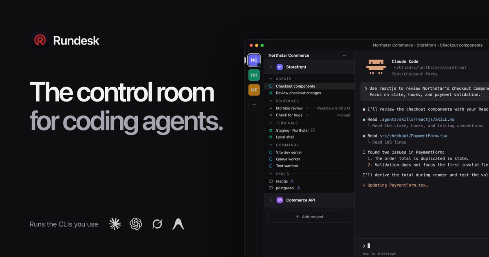

  

  Run coding agents across all your projects, and see at a glance which one is working and which needs you.

  <a href="https://github.com/rundesk-ai/rundesk-releases/releases/latest/download/Rundesk-macOS.dmg"><b>Download for macOS</b></a>
  &nbsp;·&nbsp;
  <a href="https://github.com/rundesk-ai/rundesk-releases/releases/download/windows/Rundesk-Windows-setup.exe"><b>Download for Windows</b></a>
  &nbsp;·&nbsp;
  <a href="https://rundesk.app/docs">Docs</a>
  &nbsp;·&nbsp;
  <a href="https://github.com/rundesk-ai/rundesk-releases/releases">Release notes</a>

Rundesk is a free desktop app for macOS and Windows. It launches the coding agent CLIs you already
use, signed in to your own accounts, in your project folders, and works alongside the editor you already have. Each project's terminals,
commands, prompts and schedules sit beside its agents. Six agents are built in: Claude Code, Codex, OpenCode,
Grok, Antigravity and Kimi Code, and you can add any other command as a custom agent. Each
provider's own billing applies.

This repository is where Rundesk's installers and release notes are published, and where you
report a bug or ask for a feature.

## Install

| | macOS | Windows |
|---|---|---|
| Download | [Rundesk-macOS.dmg](https://github.com/rundesk-ai/rundesk-releases/releases/latest/download/Rundesk-macOS.dmg) | [Rundesk-Windows-setup.exe](https://github.com/rundesk-ai/rundesk-releases/releases/download/windows/Rundesk-Windows-setup.exe) |
| Versions | macOS 13.3 or later | Windows 10 version 1809 or later, or Windows 11 |
| Hardware | Apple silicon | 64-bit (x64) |

Both links always give you the latest version. You also need at least one coding agent CLI, such as
Claude Code or Codex, signed in with your own account.

**On macOS,** open the DMG and drag Rundesk to Applications. The DMG is signed with a Developer ID and
notarized by Apple, so it opens even when you are offline.

**On Windows,** run the installer. It installs Rundesk for you alone, with no administrator needed,
and fetches WebView2 if it is missing. The installer is not code-signed, and each release reaches
Windows once its Windows build is added, which can be later than the Mac build.

Then open Rundesk, choose **Create workspace**, and add a project folder with **Add project**. The
[Quick start](https://rundesk.app/docs/quick-start) takes you from there to your first agent.

## Updates

Once installed, Rundesk updates itself. It looks for a newer release at every launch and while it is
open. At launch it installs the update at once; while you work, an update icon appears at the foot of
the rail, and Rundesk waits for you to choose **Restart and update**, since updating stops your
running commands, agents and terminals. A download that is not signed by Rundesk is refused.

[Releases](https://github.com/rundesk-ai/rundesk-releases/releases) lists what changed in each
version. To hear about each one, watch this repository for releases (**Watch › Custom › Releases**).

## Docs

[rundesk.app/docs](https://rundesk.app/docs) covers every part of Rundesk: workspaces and projects,
agents, terminals and commands, skills, schedules, integrations and settings.

## Report a bug or ask for a feature

The quickest way is from Rundesk itself: **Settings › About** has **Report a bug** and **Request a
feature**, which open the form in your browser with your Rundesk version filled in. You submit it
under your own GitHub account.

- [Report a bug](https://github.com/rundesk-ai/rundesk-releases/issues/new?template=bug_report.yml):
  what went wrong, the steps that make it happen, what you expected and what happened instead.
  The steps help most.
- [Request a feature](https://github.com/rundesk-ai/rundesk-releases/issues/new?template=feature_request.yml):
  the problem you are trying to solve, what you want to be able to do, and how you would know it
  is done.

Before you file one, look through [the open issues](https://github.com/rundesk-ai/rundesk-releases/issues).
If yours is there, add a 👍 to it: the votes decide what gets built first.

Issues are public, so leave passwords, keys and private code out of them.

## Privacy

Rundesk runs on your computer, and your agents run with your own CLIs and accounts. About the app
itself, Rundesk sends two kinds of data: anonymous usage counts, which never carry a name, a path, a
prompt or any output, and crash reports. You can switch off either one under **Privacy** in
**Settings › About**. The [Privacy Policy](https://rundesk.app/privacy) lists what each one holds.

---

  <a href="https://rundesk.app">rundesk.app</a>
  &nbsp;·&nbsp;
  <a href="https://rundesk.app/privacy">Privacy</a>
  &nbsp;·&nbsp;
  <a href="https://rundesk.app/terms">Terms</a>
   
  © 2026 TMAROIS, LLC

