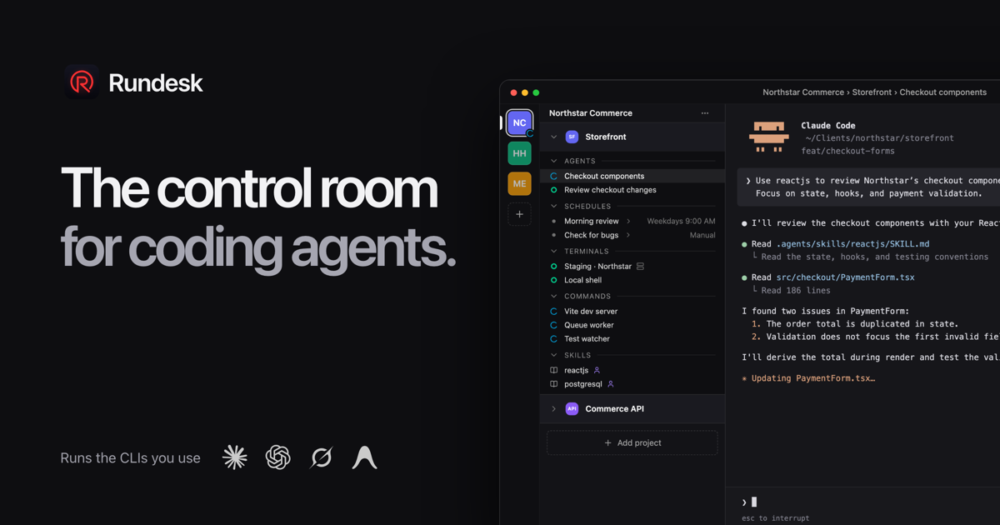

  

<h1 align="center">Rundesk</h1>

  <b>The control room for coding agents.</b> 
  Run Claude Code, Codex and other agents across all your projects, with their terminals, prompts and schedules in one window.

  <a href="https://github.com/rundesk-ai/rundesk-releases/releases/latest"><b>Download for macOS</b></a>
  &nbsp;·&nbsp;
  <a href="https://rundesk.app">Website</a>
  &nbsp;·&nbsp;
  <a href="https://github.com/rundesk-ai/rundesk-releases/releases">Release notes</a>
  &nbsp;·&nbsp;
  <a href="#tell-us-what-you-think">Share feedback</a>

  
  
  

---

## Why Rundesk

Coding agents are fast, but running several of them across several projects turns into a wall of
terminal tabs. Rundesk gives each project a home: its agents, terminals and commands side by side,
so you always know what is running, what is done and what needs you.

| | |
|---|---|
| 🗂️ **Every client's work together** | Give each client a workspace with its projects, terminals and agents. Your side projects are a click away. Stay signed in to personal and work Claude or Codex accounts and pick the one each project needs. |
| 🤝 **One agent builds, another reviews** | Let Claude hand a review to Codex, then bring the findings back. Both sessions stay with their project, and you decide what agents can access. |
| 🖥️ **Terminals organized by project** | Dev servers, tests and SSH sessions sit with the code they belong to. Save commands and server notes for the next time you need them. |
| 🔁 **Reusable prompts and schedules** | Turn the work you repeat into saved prompts: check for bugs, fix failing tests, review slow queries. Run them on demand or on a schedule. |
| 📚 **Skills** | Teach agents how you build, with your standards for React, PostgreSQL, testing and more. Manage skills in one library and share them across projects. |
| 🔔 **Know when to step in** | Get notified when work finishes or an agent needs an answer, in the app or through macOS notifications. Stop watching tabs. |

**Works with the CLIs you already use:** Claude Code, Codex, Grok and Antigravity. Rundesk runs
your installed agents with their existing accounts, in your own project folders. No new editor,
no moving your code.

## Install

1. [Download the latest DMG](https://github.com/rundesk-ai/rundesk-releases/releases/latest).
2. Open it and drag **Rundesk** to **Applications**.
3. Open Rundesk and add a project folder.

Rundesk is free and needs macOS 13.3 or later on Apple Silicon. It updates itself when you open it.

**Your work stays on your Mac.** Projects, settings and terminal history are stored locally. Rundesk
has no account, no analytics and no tracking. Read the [Privacy Policy](https://rundesk.app/privacy).

## Tell us what you think

Rundesk is young and shaped by the people who use it. Every issue is read, and your feedback
decides what comes next.

- 🐞 **Something broken?** [Report a bug](https://github.com/rundesk-ai/rundesk-releases/issues/new?template=bug_report.yml). Reporting from Rundesk’s **Settings → About** fills in your version for you; the steps to reproduce it help most.
- 💡 **Missing something?** [Request a feature](https://github.com/rundesk-ai/rundesk-releases/issues/new?template=feature_request.yml). Tell us the problem you are trying to solve, not only the fix you have in mind.
- 👍 **Want something that is already asked for?** Add a 👍 to [the open issues](https://github.com/rundesk-ai/rundesk-releases/issues). We use them to decide what to build first.
- 👀 **Follow along.** Watch this repository for releases (Watch → Custom → Releases) to hear about each new version.
- ⭐ **Like it?** Star the repository and tell a friend who runs coding agents. It helps more than you think.

Issues are public, so please leave passwords, keys and private code out of them.

---

  <a href="https://rundesk.app">rundesk.app</a>
  &nbsp;·&nbsp;
  <a href="https://rundesk.app/privacy">Privacy</a>
  &nbsp;·&nbsp;
  <a href="https://rundesk.app/terms">Terms</a>
   
  © 2026 TMAROIS, LLC

